# Grand Theft Auto VI — Fan Project

<p align="center">
  Proyecto personal inspirado en Grand Theft Auto VI, desarrollado con Astro, Tailwind CSS y GSAP.
</p>

<p align="center">
    Una recreación visual de la experiencia web de GTA VI, explorando animaciones, transiciones y diseño responsive.
</p>

# Vista previa de nuestra aplicación
<p align="center">
    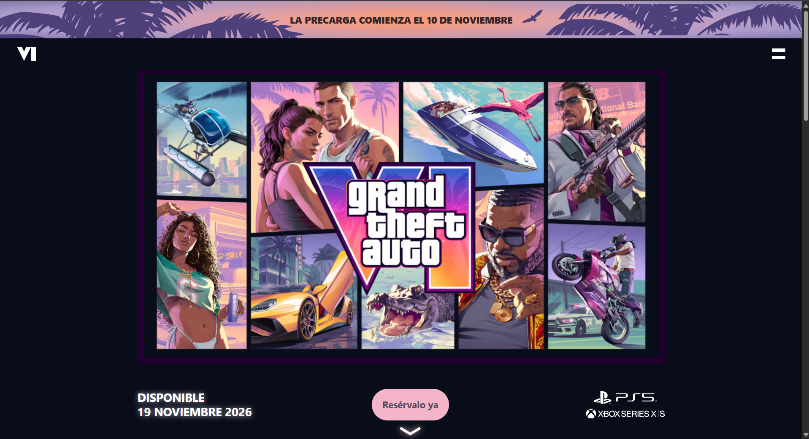
</p> 

# Descripción del proyecto

**Este proyecto consiste en una recreación visual inspirada el el sito web oficial de Grand Theft Auto VI.**
**El objetivo fue desarrollar una experiencia web dinámica e interactiva, poniendo en práctica diferentes tecnologías y técnicas de desarrollo frontend. A lo largo del proyecto se implementaron animaciones, efectos visuales, transiciones y diseños adaptables a diferentes dispositivos.**

**El sitio está compuesto por tres secciones principales:**

* Inicio: presentación visual con un mosaico de imágenes, animaciones de entrada. Navabar y un banner que aparecen utilizando animaciones, un menú interactivo de navegación y finalmente una sección de tráiler y una sección de tarjetas con referencia al juego con efectos de brillo.
* Personajes: tarjetas con información e imágenes de algunos personajes del juego.
* Explorar: recorrido visual por diferentes lugares y ambientes de Leonida, acompañado de efectos de desplazamiento y animaciones.

# Características principales
- Diseño visual inspirado en el sitio oficial de GTA VI.
- Diseño responsive adaptado a dispositivos móviles, tablets y escritorio.
- Animaciones de entrada y transiciones desarrolladas con GSAP.
- Efectos de revelado mediante máscaras (*Mask Reveal*).
- Efectos Parallax y animaciones vinculadas al desplazamiento (*Scroll-driven animations*).
- Navegación mediante desplazamiento programático hacia secciones específicas.
- Efectos Hover Glow en las tarjetas para resaltar su interacción visual.(*Glow Effect*).
- Menú de navegación interactivo con GSAP.
- Animaciones basadas en scroll utilizando GSAP ScrollTrigger.

# Tecnologías utilizadas

- Astro: framework utilizado para estructurar y desarrollar las diferentes páginas y componentes del proyecto.
- Tailwind CSS: utilizado para crear los estilos, diseños y adaptar la interfaz a diferentes tamaños de pantalla.
- JavaScript: utilizado para gestionar las interacciones y funcionalidades del sitio.
- GSAP: biblioteca utilizada para desarrollar animaciones, transiciones y efectos visuales.
- GSAP ScrollTrigger: plugin utilizado para controlar animaciones y efectos vinculados al desplazamiento de la página.

# Sección del Tráiler GTA VI
<p align="center">
    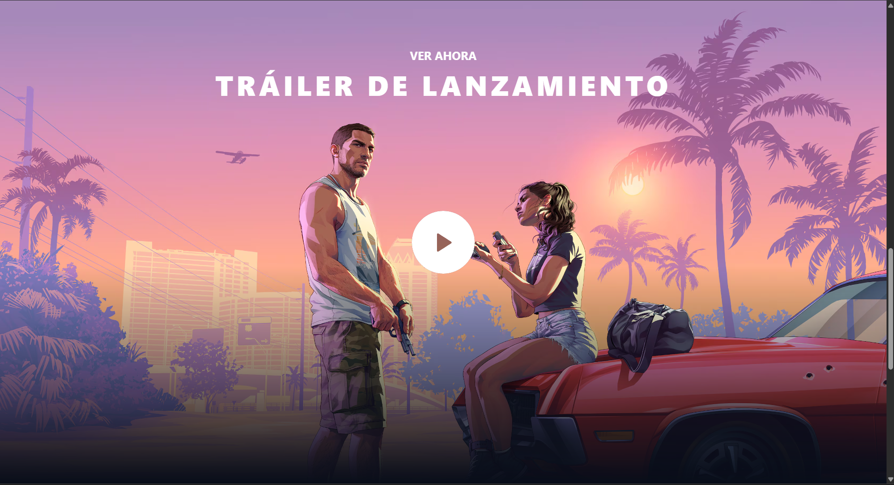
</p>

# Instalación y ejecución local 
**Para ejecutar este proyecto en tu entorno local, sigue los siguientes pasos.**
#### 1. Requisitos previos
**Antes de comenzar, asegúrate de tener instalado:**
* Node.js (versión 22.22.0 o superior).
* npm (incluido con Node.js).

#### 2. Clonar el repositorio
```bash
    git clone URL_DE_TU_REPOSITORIO
```

#### 3. Entrar al directorio del proyecto
```bash
    cd clon-gta-vi
```

#### 4. Instalar las dependencias
```bash
    npm install
```

#### 5. Iniciar el servidor de desarrollo
```bash
    npm run dev
```

#### 6. Abrir el proyecto
**Abre en tu navegador la siguiente dirección:**

#### http://localhost:4321/

# Vistas de las secciones de la aplicación web desarrollada

<p align="center">
    <strong>Página de inicio mosaico de images, banner, navbar y release de la pagina.</strong>
</p>
<div align="center">
    
    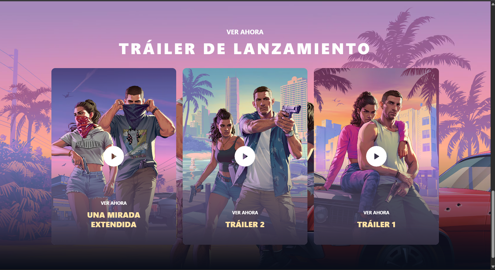
</div>
<br>

<p align="center">
    <strong>Vista del menú interactivo que permite navegar en nuestra página web.</strong>
</p>
<div align="center">
    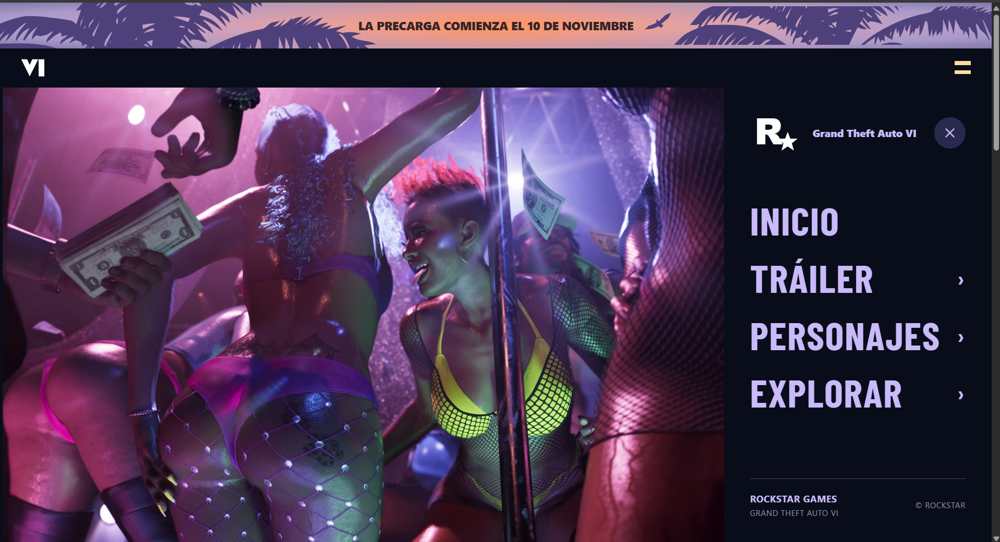
</div>
<br>

<p align="center">
    <strong>Vista de la página de personajes donde se muestran tarjetas de algunos personajes del juego igual que en todas nuestras secciones tienen su efecto especial con animaciones.</strong>
</p>
<div align="center">
    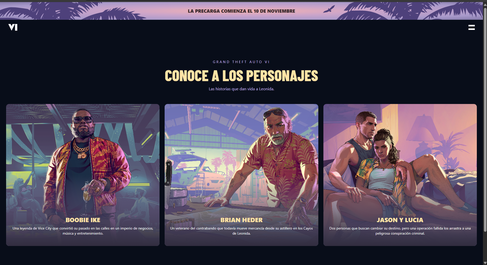
</div>
<br>

<p align="center">
    <strong>Página de la sección explorar de nuestra aplicación aquí tenemos tres secciones con alguna imagen relacionada a su apartado un título,subtitulo y una descripción, esta parte es donde se aplicó el efecto Parallax en nuestra página web.</strong>
</p>
<div align="center">
    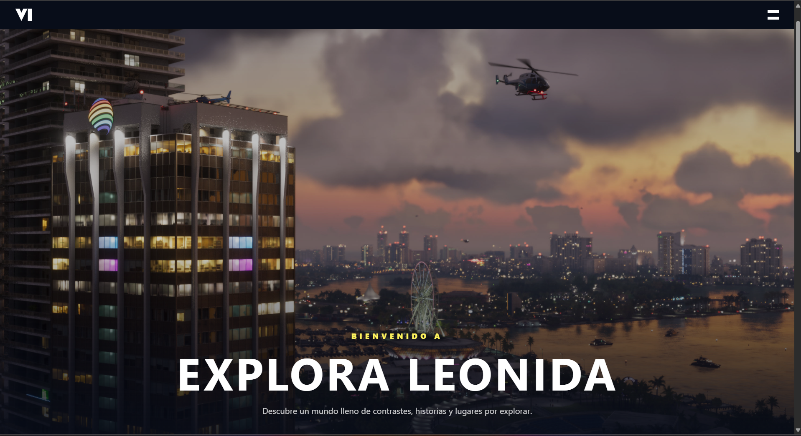
    
</div>
<br>

# Diseño responsive

**El sitio fue adaptado para ofrecer una experiencia visual y de navegación adecuada en diferentes tamaños de pantalla, incluyendo dispositivos móviles, tablets y escritorio.**

**Se realizaron ajustes en la distribución de los elementos, tamaños, imágenes y secciones para mantener una presentación consistente en los distintos dispositivos.**
<br>

## Vista móvil
<div align="center">
    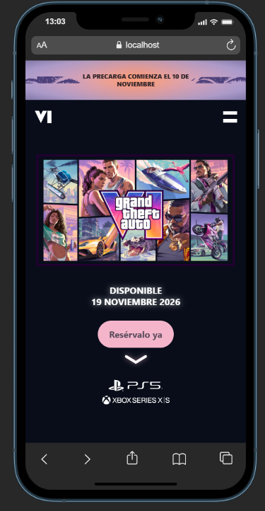
    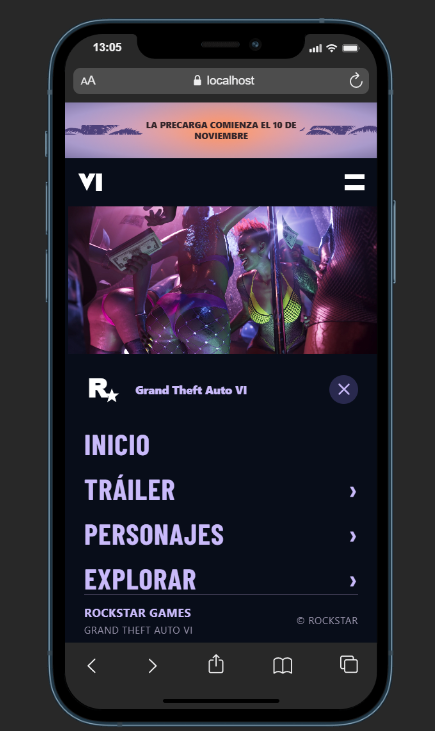
</div>
<br>

## Vista tablet
<div align="center">
  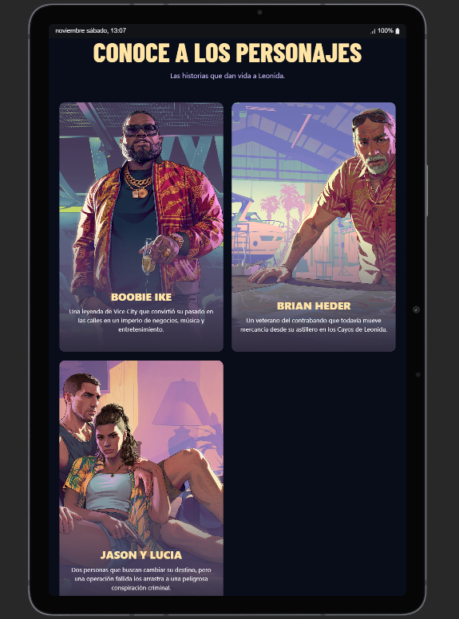
  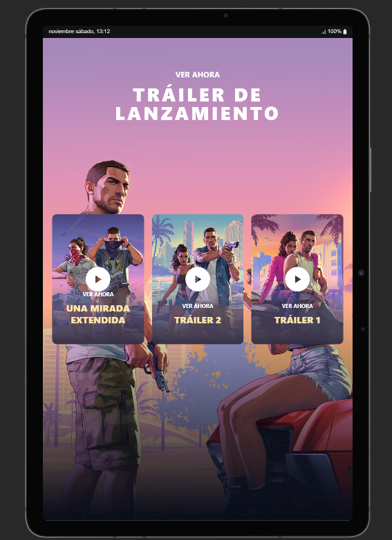
    
</div>
<br>
<br>

# Demostraciones y efectos visuales

**En esta sección se muestran algunas de las animaciones e interacciones implementadas en el proyecto, utilizando GSAP, ScrollTrigger, un poco de CSS y JavaScript.**

## Animación de entrada — Inicio

**La página principal cuenta con una secuencia de animación inicial desarrollada con GSAP, encargada de presentar progresivamente los elementos visuales del sitio.**

## Efectos implementados:

1. **Revelado mediante máscaras:** las imágenes aparecen progresivamente mediante animaciones que controlan su visibilidad.

2. **Animación del mosaico:** las imágenes se presentan mediante una secuencia de animaciones coordinadas.

3. **Aparición de logotipos:** los logotipos de GTA VI aparecen mediante transiciones de posición y opacidad.

4. **Secuenciación de animaciones:** se utiliza GSAP Timeline para coordinar los tiempos y la ejecución de los diferentes efectos.

<br>

<p align="center"><strong>A continuación presentamos la animación de inicio.</strong></p>
<div align="center">
    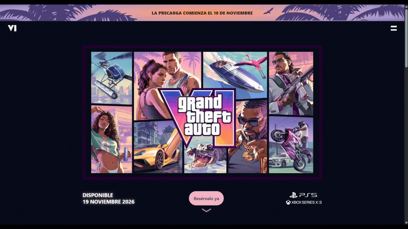
</div>
<br>

## Menú de navegación interactivo

**Se desarrolló un menú de navegación interactivo con animaciones gestionadas mediante GSAP.**

## Efectos implementados:

1.  **Animación de apertura:** aparición progresiva del menú mediante transiciones de opacidad y movimiento.
2. **Animación de cierre:** transición inversa para ocultar el menú.
3. **Secuenciación de animaciones:** utilización de GSAP Timeline para coordinar los diferentes elementos visuales.
4. **Navegación entre páginas:** enlaces que permiten desplazarse entre las diferentes secciones del sitio.
<br>
<p align="center"><strong>Menú Interactivo en la página web.</strong></p>

<div align="center">
    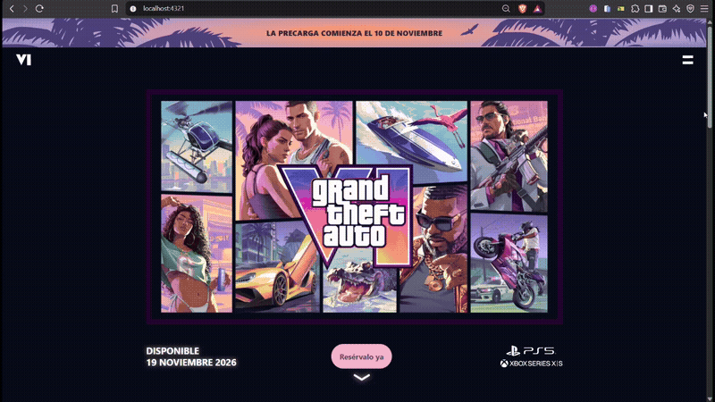
</div>
<br>

## Animación de tarjetas mediante ScrollTrigger

**Se implementó una animación de aparición progresiva para las tarjetas de la página principal, utilizando GSAP y su plugin ScrollTrigger.**


## Efectos implementados:

1. **Detección del desplazamiento:** ScrollTrigger controla cuándo comienza la animación según la posición de la página.
2. **Aparición progresiva:** las tarjetas aparecen mediante transiciones de opacidad y desplazamiento.

3. **Secuenciación:** se utiliza la propiedad stagger de GSAP para establecer un intervalo entre la aparición de cada tarjeta.

3. **Control de reproducción:** la animación se activa al entrar en el área de visualización y puede revertirse al desplazarse hacia arriba.
<br>
<p align="center"><strong>Animación con ScrollTrigger.</strong></p>
<div align="center">
    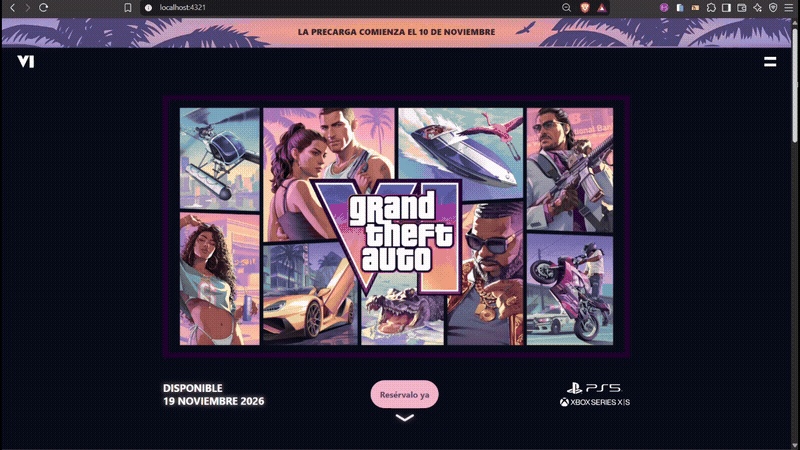
</div>
<br>

## Efecto Parallax — Explorar

**Se implementó un efecto Parallax utilizando GSAP y ScrollTrigger para generar una sensación de profundidad durante el desplazamiento por las diferentes secciones de la página.**

## efectos implementados

1. **Movimiento de imágenes:** desplazamiento vertical de las imágenes mientras el usuario recorre cada sección.
2. **Control mediante scroll:** sincronización del movimiento con el desplazamiento de la página.
3. **Animación progresiva:** utilización de scrub para vincular directamente el progreso de la animación con el scroll.
4. **Profundidad visual:** combinación de desplazamiento y escala para crear una experiencia visual más dinámica.
<br>
<p align="center"><strong>Efecto Parallax en la página de Explorar.</strong></p>
<div align="center">
    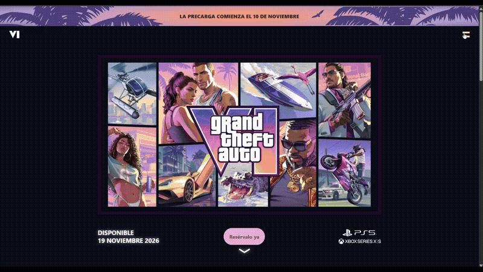
</div>
<br>

## Efecto Hover Glow — Tarjetas de personajes

**Se implementó un efecto visual interactivo en las tarjetas de personajes para resaltar su apariencia al interactuar con ellas mediante el cursor.**

## Efectos implementados:

1. **Iluminación dinámica:** efecto de brillo que resalta visualmente las tarjetas.
2. **Interacción Hover:** activación del efecto al posicionar el cursor sobre las tarjetas.
3. **Animación escalonada (Stagger):** permite controlar el intervalo de tiempo entre la aparición de cada tarjeta, creando una secuencia de animación progresiva.
4. **Transiciones visuales:** cambios progresivos que generan una interacción más fluida.
<br>
<p align="center"><strong>Efecto Hover Glow, crea un efecto de brillo cuando pasamos por encima de las tarjetas también colocamos su efecto de animación escalonada con GSAP.</strong></p>
<div align="center">
    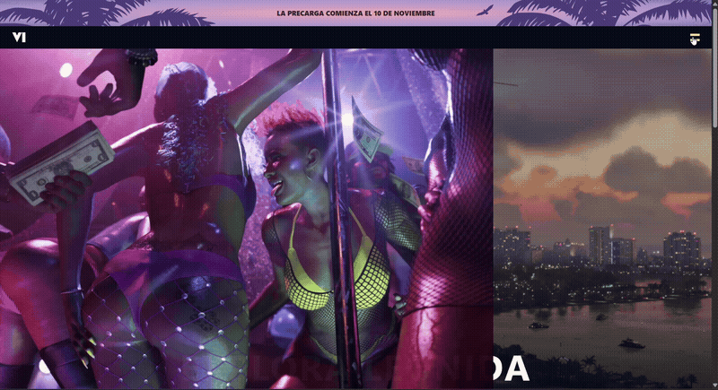
</div>
<br>

# 👨‍💻 Autor:

## **[Mario Martínez Aguilar](https://github.com/MarioMartinezAguilar)**

## Desarrollador Web Full Stack

**Proyecto desarrollado como parte de mi aprendizaje y crecimiento profesional en el desarrollo web, poniendo en práctica tecnologías frontend, animaciones e interacciones modernas.**

# 🎮 Créditos
**Rockstar Games: Grand Theft Auto VI y su identidad visual, utilizados como inspiración para este proyecto personal.**


 


